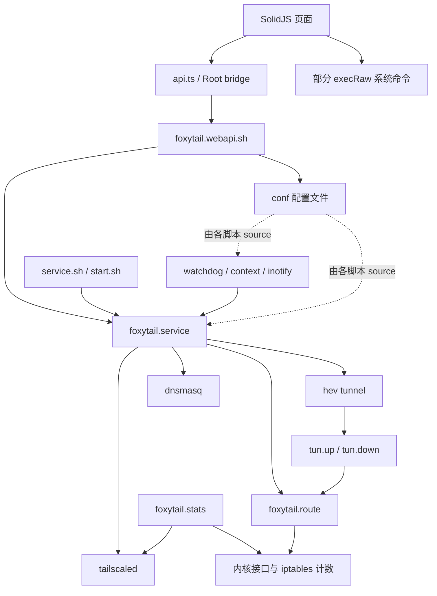

# FoxyTail 代码质量、架构与设计审查报告

审查日期：2026-09-09
审查基线：`b0f687a26678818cb5aba2d1ae5b462906f64965`
范围：安装/升级/卸载、Shell 服务与网络控制、配置与恢复、统计、WebAPI、SolidJS WebUI、测试与发布链路。

## 1. 总体判断

**项目已经具备清楚的功能分组和可用的构建基础，但尚未建立与“以 root 修改系统网络”相匹配的状态管理、资源隔离和验证机制。建议先修复本报告中的 P1 问题，再扩展功能或把当前实现作为稳定版本发布。**

主要问题集中在五个方面：

1. **数据与代码的边界不牢固。** 恢复配置的校验可以被绕过，随后配置会被 root Shell 执行。
2. **网络资源隔离不完整。** 有独立链名和表号，但没有保护系统保留表、共享 fwmark 位以及原生 tailscaled 自己的路由规则。
3. **缺少统一的生命周期控制。** 安装器、启动入口、WebAPI、看门狗、网络环境规则分别修改同一组进程和文件，没有完整的串行化、事务或状态协调。
4. **成功、就绪与生效混在一起。** 文件保存成功不等于配置已经生效；进程存在不等于隧道可用；文件存在不等于备份成功。
5. **测试覆盖偏向前端渲染。** 现有类型检查和冒烟测试能通过，但实际的恢复、路由、统计和失败交互仍有可复现缺陷。

本报告列出 **24 项具体问题：6 项 P1、18 项 P2**，并另列组织与长期设计建议。P1 表示应优先解决的安全、网络隔离或升级一致性问题；P2 表示明确的功能、可靠性或工程保障问题。没有把依赖环境尚未确定的现象写成已在 Android 真机复现的事实。

## 2. 范围、方法和验证结果

基线有 82 个受 Git 管理的文件；按 `webui/src/`、`tailscale/scripts/`、公共 settings 和三个顶层运行脚本统计，核心文件共 52 个、9,792 行，其中包括 TS/TSX、Shell、CSS 和配置模板。逐段审查集中于有状态和有副作用的路径；UI 基础组件、图表、主题、国际化与文档也纳入检查。

本次只新增审查文档，没有修改应用源码、配置模板、锁文件或已提交的 WebUI 产物。验证依赖安装在被忽略的 `webui/node_modules/`，临时探针和生产构建放在临时目录；没有运行安装器、真实 `iptables`、路由清理、服务停止或卸载命令。

| 验证 | 结果 | 能证明的范围 |
|---|---|---|
| `pnpm --dir webui install --frozen-lockfile` | 完成，锁文件未变 | 依赖可安装 |
| TypeScript strict 类型检查 | 通过 | 编译期类型，不包含运行时 JSON 结构 |
| 中英文 i18n 检查 | 通过，200 / 200 键 | 字典键一致性 |
| 直接执行 `pnpm --dir webui smoke` | 首次失败：缺少 `.smoke/app.js` | 脚本存在未自动满足的预构建依赖 |
| 先构建 smoke bundle，再运行 smoke | 通过全部现有分组 | 13 路由 × 3 轮、任务接管/取消/替换、no-root、部分错误提示 |
| 生产构建到临时目录 | 通过 | JS 191.86 kB，gzip 56.75 kB；CSS 14.39 kB |
| 生产构建与已提交 `webroot/` 比较 | 本次输出文件逐字节一致 | 当前提交没有发现前端产物落后问题 |
| Shell 语法检查 | 21 个脚本通过 | 使用宿主机 `sh -n` / `bash -n`，不代表 Android 工具行为 |
| 自定义隔离探针 | 复现多项缺陷，见第 7 节 | 提取原函数、命令替身、合成数据和 jsdom 故障注入 |
| ShellCheck | 本机未安装，未运行 | 仓库有 CI 配置，未据此声称 CI 已通过 |
| Android / KernelSU / Magisk 真机测试 | 未执行 | 路由优先级、SELinux、设备兼容性仍需真机验收 |

本地前端检查环境：Node `v26.8.1`、pnpm `12.3.4`。因此不能把本次成功外推为所有 Node/pnpm 版本均受支持。

## 3. 当前架构及合理之处



值得保留的基础：

- 前端按页面拆分，状态轮询与长任务已有独立模块；相对于项目规模，没有必要引入大型框架。
- `tasks.ts` 使用请求对象身份防止旧 Promise 覆盖新任务，方向正确；问题出在后端进程取消缺少同样的身份约束。
- `settings.sh` 集中了路径、日志、进程与等待辅助函数，减少了重复实现。
- API 参数有单引号转义；部分配置有值域校验；安装前有暂存和二进制校验。不能因为仍有漏洞，就把这些措施全部视为无效。
- 路由使用专用链、记录 applied 参数，卸载考虑身份保留，钩子升级考虑用户修改，说明已经在处理运维边界。
- 当前生产包体积合理，实际构建与提交产物一致。**没有证据支持把“前端过重”或“本次产物陈旧”列为当前缺陷。**

现阶段的瓶颈是上述机制之间缺少统一约束，导致单个函数看似有防护，组合起来仍可能失效。

## 4. P1：优先修复的问题

### F01：恢复配置的键名校验可绕过，导入内容随后以 root 执行

位置：[键名校验](/Users/spark/Development/FoxyTail/tailscale/scripts/foxytail.webapi.sh:795)、[未知键值域兜底](/Users/spark/Development/FoxyTail/tailscale/scripts/foxytail.webapi.sh:767)、[恢复前校验](/Users/spark/Development/FoxyTail/tailscale/scripts/foxytail.webapi.sh:1035)、[运行时 source](/Users/spark/Development/FoxyTail/tailscale/settings.sh:100)。

`[A-Z_][A-Z0-9_]*` 是 Shell glob，不是正则表达式。它只约束前两个字符，末尾的 `*` 可以包含分号、空格、引号等任意内容。隔离测试中，包含无害 `printf` 的非赋值行通过了 `_conf_file_error`，随后被 Shell 执行并输出验证标记。

另外，即便修复字符校验，当前仍接受任意未知键，例如 `TS_SCRIPTS_DIR=/sdcard/replacement` 或 `PATH=/sdcard/replacement`。这些不是普通业务配置，会覆盖共享脚本的执行环境。`_settings_keys` 还把现有配置内容加入可写键列表，让配置文件反过来定义自身权限边界。

触发前提是用户恢复含有恶意配置的备份；不是无需交互的远程入口，但后果可能是 root 命令执行。把恢复的 hook 停放为 `.restored` 并不能覆盖这条配置执行路径。

建议：将配置视为数据，用固定键集合解析，拒绝所有未知键和非赋值语法；运行时也复用同一解析器，避免 `source` 导入任意内容。短期至少采用严格字符排除与静态键白名单，禁止覆盖 `PATH`、内部路径及辅助变量。

验收：异常键名、环境变量键、引号逃逸、重复键、缺少末尾换行等输入均有测试；恢复失败时现有配置完全不变。

### F02：允许使用系统保留路由表，teardown 可以清空 main 表

位置：[ROUTE_TABLE 校验](/Users/spark/Development/FoxyTail/tailscale/scripts/foxytail.webapi.sh:726)、[IPv6 清表](/Users/spark/Development/FoxyTail/tailscale/scripts/foxytail.route:341)、[IPv4 清表](/Users/spark/Development/FoxyTail/tailscale/scripts/foxytail.route:344)。

WebAPI 允许 `ROUTE_TABLE=1..65535`，其中包含 253、254、255。`route_teardown` 不验证资源归属，直接 flush 所选表。隔离探针证实 `254` 被接受，并捕获到 IPv4、IPv6 的 `route flush table 254` 调用。这里没有执行真实清表。

这与“main 表零写入”的核心承诺冲突。即使默认配置正确，首次使用非法表，或 applied 状态文件缺失时，停止/重载也存在破坏系统路由的路径。表号只是可配置数字，并不能证明整张表属于本模块。

建议：在统一配置入口和实际清理入口双重拒绝系统保留表；检查专用表冲突；优先删除本模块记录的路由条目。若保留整表 flush，必须有明确且可验证的独占归属。

验收：保留表、冲突表、丢失/损坏的 `route.state` 都不会触发清理系统表。

### F03：无掩码 MARK 会覆盖 Android 和其他组件使用的 fwmark 位

位置：[IPv4 MARK](/Users/spark/Development/FoxyTail/tailscale/scripts/foxytail.route:68)、[IPv6 MARK](/Users/spark/Development/FoxyTail/tailscale/scripts/foxytail.route:113)、[fwmark 匹配](/Users/spark/Development/FoxyTail/tailscale/scripts/foxytail.route:161)。

规则使用 `--set-xmark ${FWMARK}`，没有指定掩码；默认 `all` 又覆盖所有本机 OUTPUT 包，没有按目标网段或本组件控制流量收窄。无掩码写入会替换原有 mark，不只是设置一个 FoxyTail 标志。

Android 的网络选择、其他代理及 tailscaled 的绕行标记均可能共享这个字段。尤其当前固定的 Android Tailscale 分支确实依赖 `LinuxBypassMarkNum` / `LinuxFwmarkMaskNum`；覆盖这些位后，控制流量与出口节点回避规则可能失效。具体断网或回环条件需在目标内核验证，**覆盖已有位的行为本身由规则语义可以确定**。

建议：定义并验证可使用的 mark/mask，保留不属于本模块的位；对自己的 daemon、隧道转发 socket 和目标网段设计明确的绕行规则；检测上游/系统位冲突。不能仅靠选择一个不重复的完整十六进制数解决共享位空间问题。

验收：为带有非 FoxyTail mark 的包执行路由测试，确认原有位保留；验证 bridge/tun、出口节点、Android 默认网络与共存代理的组合。

### F04：原生 tun 模式的按应用路由没有约束上游 tailscaled 路由

位置：[native tun 启动参数](/Users/spark/Development/FoxyTail/tailscale/scripts/foxytail.service:91)、[native companion 路由](/Users/spark/Development/FoxyTail/tailscale/scripts/foxytail.service:167)、[FoxyTail 的 ip rule](/Users/spark/Development/FoxyTail/tailscale/scripts/foxytail.route:168)。

FoxyTail 的 `selected` / `bypass` 只控制自己的 MARK 和表 1052；native tailscaled 同时安装自己的表 52 和规则。核对当前固定的 `v1.98.8-android` 源码可见，Android 分支有针对 Tailnet 网段的规则和“不带 bypass mark 则查表 52”的规则，并不包含 FoxyTail 的 UID 选择条件。

因此，未被 FoxyTail 标记或被它 RETURN 的应用，仍可能通过上游规则进入 Tailscale；把自己的规则改优先级也不足以自动给未选应用建立排除路径。这是两套路由控制器同时拥有网络决策权的问题。

证据：[固定 Android 分支的路由实现](https://github.com/anasfanani/tailscale-android-cli/blob/v1.98.8-android/wgengine/router/osrouter/router_linux.go)。已核对源码，未在设备内核中抓取实际规则；真机验收是完成修复的必要条件。

建议：为各运行模式明确唯一的路由控制策略。native 模式需让 UID 排除与上游表 52/mark 机制协同，或在能力未完成前限制该模式的按应用选项并准确呈现能力。

验收：使用两个真实 UID，分别验证 selected/bypass 下 Tailnet、子网和出口节点的路径，而不是只检查 FOXY 链是否存在。

### F05：升级先搬走运行目录和脚本，再尝试停止旧进程

位置：[升级搬移顺序](/Users/spark/Development/FoxyTail/customize.sh:238)、[升级后才调用 postinstall](/Users/spark/Development/FoxyTail/customize.sh:371)、[postinstall 停驻留组件](/Users/spark/Development/FoxyTail/tailscale/scripts/start.sh:45)。

安装器把 `run/`、`bin/` 和大部分脚本移入版本备份，然后安装新文件，最后才调用 `start.sh postinstall` 停止 stats/watchdog/context。此时旧进程的 PID 文件已经随旧 `run/` 被移走，新路径下的 stop 找不到原进程。

旧驻留进程可能继续执行旧配置或旧脚本上下文，却向新的运行路径读写；后续正常启动又可能产生重复实例。旧 applied 路由状态也已搬走，清理无法可靠获知旧表号与 mark。暂存和校验保护了下载阶段，却没有保护“切换到新版本”这一阶段。

建议：下载验证完毕后先通过旧版本控制入口停止并确认所有组件退出，再切换版本目录；把 run 状态与需保留的数据分开。发布目录切换应可回滚，关键 mv/cp 的失败要阻止宣告安装成功。

验收：在服务运行时升级，检查不存在旧 PID、重复采集器和孤立规则；对切换中途的写入失败进行故障注入，确认可以恢复原安装。

### F06：路由的快速“幂等”判断会阻止真正修复

位置：[快速跳过逻辑](/Users/spark/Development/FoxyTail/tailscale/scripts/foxytail.route:223)、[记录的 applied 参数](/Users/spark/Development/FoxyTail/tailscale/scripts/foxytail.route:291)、[compat 跳转检测](/Users/spark/Development/FoxyTail/tailscale/scripts/foxytail.compat:133)。

快速路径只检查 MARK 链存在、某条相同 mark 的 ip rule 存在、IPv4 表非空及 IPV6 值。没有验证 OUTPUT 跳转、STAT 链、具体 MARK 规则、UID/Scope/Subnets、路由设备或完整 IPv6 状态。`fwmark_rule_present` 也没有验证 lookup 表。

隔离测试构造了“链仍存在，但需要恢复的跳转不存在，同时配置已改变”的环境，函数直接输出 `policy routing already applied; skipping.`，没有进行任何修复。`compat check` 用 `iptables -S | grep FOXY_` 检测跳转，也会被 `-N FOXY_MARK` 这类链声明误导。

建议：取消不完整的提前返回，或者使用完整的规范化 desired/applied 指纹并验证实际内核状态。对内置链使用明确的 `-C OUTPUT -j ...`，对规则校验 mark、mask、表及 priority 的完整元组。

验收：只删除 OUTPUT 跳转、删除一个子网、清空 STAT 链、改变 UID、删除 IPv6 rule 后，再次 apply 都能恢复正确状态。

## 5. P2：功能、可靠性与工程保障问题

### F07：按 UID 流量规则被前面的无条件 RETURN 遮蔽

位置：[先加入 RETURN](/Users/spark/Development/FoxyTail/tailscale/scripts/foxytail.route:260)、[后加入 UID 规则](/Users/spark/Development/FoxyTail/tailscale/scripts/foxytail.route:268)、[采集 UID 计数](/Users/spark/Development/FoxyTail/tailscale/scripts/foxytail.stats:115)。

全新 apply 先追加 `FOXY_STAT -j RETURN`，再追加各 UID 的 RETURN。数据包到第一条就返回，后面的 UID 规则无法命中。隔离捕获的规则顺序与此一致。

此外，这个链挂在所有 OUTPUT 流量上，没有仅统计 Tailscale 流量的条件；采集器又把出站字节写入 `rx`，仅读取 IPv4。因此即便调整顺序，也需要明确“上传/下载”“全部流量/Tailscale 流量”和双栈统计的口径。

建议：按业务口径重新设计计数链，UID 规则置于兜底之前，正确区分方向与接口，统一前后端字段。验收要包含至少两个 UID 的已知字节量，以及与隧道无关的流量。

### F08：统计使用首尾差或最大最小差，重启与跨时段时结果失真

位置：[hourly 聚合](/Users/spark/Development/FoxyTail/tailscale/scripts/foxytail.stats:181)、[daily 聚合](/Users/spark/Development/FoxyTail/tailscale/scripts/foxytail.stats:205)、[peer topn](/Users/spark/Development/FoxyTail/tailscale/scripts/foxytail.stats:225)、[UID 聚合](/Users/spark/Development/FoxyTail/tailscale/scripts/foxytail.webapi.sh:558)。

接口计数器在隧道重建时归零；peer 计数器也会随会话变化。序列 `1000 → 1500 → 0 → 200` 的可观测增量是 700，但当前 daily 输出 0，topn 输出 1500。以小时/日内首尾相减还漏掉跨桶边界的采样区间。

建议：按时间顺序计算相邻样本差值，记录采集/daemon/interface generation；重置时按明确规则起新段，再按时间桶聚合增量。缺采样与零流量应可区分。验收包含重启、跨小时/日、离线后恢复和计数器重置。

### F09：配置文件的原子替换不能防止并发保存丢失更新

位置：[单键读改写](/Users/spark/Development/FoxyTail/tailscale/scripts/foxytail.webapi.sh:840)、[前端可独立并发保存](/Users/spark/Development/FoxyTail/webui/src/pages/Settings.tsx:45)、[mode 另一路写配置](/Users/spark/Development/FoxyTail/tailscale/scripts/foxytail.service:412)。

两个 `settings-set` 可以同时读到旧文件，各自生成新版本，最后一次 mv 覆盖前一次。隔离测试同时保存 WATCHDOG=off 与 STATS_INTERVAL=120，两次均返回 `ok:true`，最终 WATCHDOG 仍为 on。前端快速编辑不同字段就可能触发，不限于多个 WebUI 会话。

建议：统一所有写配置入口，持有同一个锁覆盖完整读改写，或使用版本号比较交换；一组设置采用批量校验提交。验收必须测试不同键并发、同键并发和 mode-set 与 settings-set 并发。

### F10：设置保存后缺少生效机制，重启主服务也无法刷新驻留组件

位置：[settings-set 仅写文件](/Users/spark/Development/FoxyTail/tailscale/scripts/foxytail.webapi.sh:826)、[watchdog 启动时加载](/Users/spark/Development/FoxyTail/tailscale/scripts/foxytail.watchdog:13)、[stats 启动时加载](/Users/spark/Development/FoxyTail/tailscale/scripts/foxytail.stats:15)、[主服务重启](/Users/spark/Development/FoxyTail/tailscale/scripts/foxytail.service:516)。

WATCHDOG、WATCHDOG_INTERVAL、STATS_INTERVAL 在驻留进程开始时读取一次；设置页只显示已保存。`foxytail.service restart` 只重启 tailscaled 与网络 companion，不重启这些驻留进程。因此关掉 WATCHDOG 或改变采集间隔，当前后台仍可能继续按旧值运行。

建议：每个设置声明 `live/reload/restart` 生效方式；保存操作返回 desired/applied 状态，控制层按依赖刷新组件。验收要观察实际行为变化，不能只读回配置文件。

### F11：把“tailscaled 进程在”当作整个服务已经启动

位置：[start 提前返回](/Users/spark/Development/FoxyTail/tailscale/scripts/foxytail.service:110)、[companion 失败后的返回](/Users/spark/Development/FoxyTail/tailscale/scripts/foxytail.service:154)、[watchdog 只检查主进程/后端](/Users/spark/Development/FoxyTail/tailscale/scripts/foxytail.watchdog:108)、[postinstall 提前退出](/Users/spark/Development/FoxyTail/tailscale/scripts/start.sh:61)。

例如 hev 启动失败，但 tailscaled 存活，首次 start 报错；第二次 start 却立即成功返回，不再修复 hev、路由和 DNS。看门狗也不会因这些层失效而修复。首次未登录时 DNS prerequisite 不满足，之后完成登录亦没有统一触发器重新应用 DNS。

另外，postinstall 启动主服务后就退出，不走正常入口中启动 stats/watchdog/context 的分支；首次安装后不重启设备时，这些能力并未全部启动。

建议：把 start 定义为“使整个期望状态达到就绪”，为每个组件保留 observed state，重复调用可以修复局部失败。明确 postinstall 的完整启动语义。验收包括主 daemon 正常、hev 死亡/路由缺失/DNS 尚未就绪的各类组合。

### F12：DNS 共存检查漏掉 mangle/IPv6，degraded 状态又被进程存活覆盖

位置：[仅检查 IPv4 nat](/Users/spark/Development/FoxyTail/tailscale/scripts/foxytail.compat:110)、[冲突后仍设 running](/Users/spark/Development/FoxyTail/tailscale/scripts/foxytail.dns:172)、[status 覆盖 degraded](/Users/spark/Development/FoxyTail/tailscale/scripts/foxytail.dns:217)。

TPROXY 通常在 mangle 表，但探针只读取 `iptables -t nat -S`；也没有 IPv6 对称检查。另一个方向上，只要 nat 中出现别的 `--dport 53` 行就认为冲突，没有确认 target 或实际可达性。

发现冲突而跳过 REDIRECT 后，`dns_start` 最终仍写 running；即便曾记录 degraded，`dns_status` 也会因 dnsmasq 进程存在而重新报告 running。于是 UI/CLI 的健康状态不能说明分流是否真正有效。

建议：区分 process、listener、redirect、upstream 和 effective DNS 状态，检查相关 family/table/target/挂载路径；保留 degraded 原因。验收包括 nat REDIRECT、mangle TPROXY、IPv6 劫持和仅规则残留四种情况。

### F13：取消操作按全局命令模式杀进程，没有请求级隔离

位置：[取消模式](/Users/spark/Development/FoxyTail/webui/src/api.ts:185)、[异步清理](/Users/spark/Development/FoxyTail/webui/src/api.ts:202)、[旧任务取消后立即启动新任务](/Users/spark/Development/FoxyTail/webui/src/tasks.ts:47)。

`tailscale.*ping`、`tailscale.*login`、`tailscale.*file cp` 并不限定 socket、模块或某次请求。同类任务替换时，前端发出旧任务的异步 pkill，立即启动新任务；后执行的清理仍可能匹配新任务或其他会话/CLI 的进程。

现有 smoke 把所有 pkill 模拟为立即成功，因此“旧 Promise 不污染新状态”测试通过，并不能证明“新后端进程不会被杀”。固定模式没有用户输入注入，不代表它具备正确的资源归属。

建议：后端生成/接收 operation ID，记录并验证 PID 与启动身份，取消只能作用于该操作；等待旧操作确认退出后再启动互斥新操作。将“前端停止等待”和“后端已取消”作为不同状态。验收包括双会话、同类替换和旁路 CLI 同时运行。

### F14：首次加载失败时，多个页面永远显示骨架而隐藏错误

位置：[Peers 外层 Show](/Users/spark/Development/FoxyTail/webui/src/pages/Peers.tsx:61)、[ExitNodes 外层 Show](/Users/spark/Development/FoxyTail/webui/src/pages/ExitNodes.tsx:105)、[Files 外层 Show](/Users/spark/Development/FoxyTail/webui/src/pages/Files.tsx:76)。

失败时只设置 `loadError`，数据仍是 null；外层 `Show when={data() !== null}` 永远渲染 loading fallback，内层 ErrorState 根本不会出现。jsdom 故障注入分别得到 4/3/3 个骨架元素，错误和重试按钮都不可见。

建议：统一使用明确的 loading/success/error 状态，或至少让外层条件包含错误。验收覆盖首次失败、成功后失败、重试成功和 no-root。

### F15：SOCKS5 自检使用了 HTTP 代理协议

位置：[curl 自检命令](/Users/spark/Development/FoxyTail/webui/src/pages/Tunnel.tsx:61)。

`curl -x 127.0.0.1:PORT` 默认使用 HTTP proxy，不会自动识别 SOCKS5。对本地只记录请求的测试 socket 执行相同参数，首行是 `CONNECT 1.1.1.1:443 HTTP/1.1`，不是 SOCKS5 握手。健康的 SOCKS5 服务因此可能被误报故障。native tun 模式本身也没有开启该 SOCKS listener，但 UI 仍提供同一个检测按钮。

建议：显式使用 `socks5h://` 或等效 SOCKS 参数，把 listener 可用性、代理连通性和外部探测目标可达性分别显示；按运行模式提供可用检测。验收以协议握手与正常代理为准。

### F16：账户列表使用了错误的 Tailscale CLI 语法

位置：[账户列表命令与文本解析](/Users/spark/Development/FoxyTail/tailscale/scripts/foxytail.webapi.sh:440)。

代码执行 `tailscale switch list`，而当前固定 Android 上游版本的 CLI 定义是 `tailscale switch --list [--json]`。`list` 会作为待切换的账户标识，而不是列表子命令。即便修正参数，当前文本解析仍把标题行 `ID Tailnet Account` 当成账户，并把第一列 ID 用作展示 name。

证据：[固定 Android 分支 switch.go](https://github.com/anasfanani/tailscale-android-cli/blob/v1.98.8-android/cmd/tailscale/cli/switch.go)。已核对命令声明、JSON 输出与参数分支，没有运行 Android 二进制。

建议：使用 `switch --list --json`，由适配器明确映射 id、account/nickname、selected。验收使用真实上游 JSON fixture，而不是只有一个人为构造 name 的 mock。

### F17：Serve/Funnel 状态扁平化丢失协议语义，删除参数可能错误

位置：[flatten](/Users/spark/Development/FoxyTail/webui/src/pages/Serve.tsx:23)、[删除使用推导后的协议](/Users/spark/Development/FoxyTail/webui/src/pages/Serve.tsx:80)。

所有 `TCP` 键一律当成 TCP forward；Web 协议又仅按端口是否等于 443 推断。对 HTTPS:8443 的标准结构，当前函数生成一条空 target 的 tcp 和一条 http，而没有 https。删除按钮会据此传入错误协议。多个 Web path 只保留循环中的最后一个 target，Serve/Funnel 列表也没有利用 `AllowFunnel` 区分公开暴露状态。

建议：读取 TCP handler 的 HTTPS/HTTP/TerminateTLS 等真实字段，结合 Web handlers 与 AllowFunnel 建模，保留路径和公开范围。验收覆盖 HTTPS 非 443、HTTP 非 80、多路径、TCP/TLS forward 与 Funnel 状态。

### F18：底层 CLI 的 stderr 被提前丢弃，上层错误信息无法恢复

位置：[ts_cli](/Users/spark/Development/FoxyTail/tailscale/scripts/foxytail.webapi.sh:92)、[代表性调用](/Users/spark/Development/FoxyTail/tailscale/scripts/foxytail.webapi.sh:422)。

`ts_cli` 内部对 tailscale 固定 `2>/dev/null`。调用者再写 `$(ts_cli ... 2>&1)` 也拿不到已经丢弃的 stderr。隔离替身输出了明确错误并退出 42，上层只得到 `rc=42 captured=<>`，最终常被错误地提示为 timeout。

建议：读取类调用可显式静默；修改类调用保留 stderr 与真实退出码，统一翻译为结构化错误。验收应确认鉴权失败、参数错误、连接失败与真正超时能够区分。

### F19：升级的数据保留清单遗漏用户自供 dnsmasq 与已接收文件

位置：[保留清单](/Users/spark/Development/FoxyTail/customize.sh:244)、[仅安装三种固定二进制](/Users/spark/Development/FoxyTail/customize.sh:288)、[Taildrop 文件目录](/Users/spark/Development/FoxyTail/tailscale/scripts/foxytail.webapi.sh:80)。

升级把整个 `bin/` 移入备份，之后只装回 tailscaled、jq、hev；README 要求用户自行放入的 `bin/dnsmasq` 不会回到运行路径。`files/` 也不在保留清单，已接收的文件被搬到备份，当前 inbox 变空。这里是运行位置丢失，不是声称内容立刻被永久删除；同版本重装还会先删除同名版本备份。

建议：区分 immutable payload、用户扩展、持久数据、运行状态和历史备份，按类别迁移，避免由一个 basename 排除列表承担所有所有权判断。验收覆盖带 dnsmasq、自定义 hook、inbox 和历史统计的升级/同版本重装。

### F20：日志大小上限没有作用于长期运行的 daemon

位置：[rotate_log](/Users/spark/Development/FoxyTail/tailscale/settings.sh:68)、[tailscaled 打开日志](/Users/spark/Development/FoxyTail/tailscale/scripts/foxytail.service:125)、[hev 打开日志](/Users/spark/Development/FoxyTail/tailscale/scripts/foxytail.tun:93)。

tailscaled、hev、dnsmasq 的日志仅在启动前检查大小；运行期间持续增长不受 LOG_MAX_KB 控制。服务日志另有每次写前的 mv 轮转，但某些父进程长期以 `>>foxytail.log` 打开文件描述符；rename 后该描述符仍写旧 inode，日志可能分散在 `.bak`，随后被替换而不可见。日志轮转也没有跨进程协调。

建议：为长期输出使用明确的 logger/轮转策略，确认 writer reopen 或选择有约束的替代方案；不要把“启动时 rotate 一次”当成运行时容量限制。验收包含连续运行超限与轮转后的日志可读性。

### F21：备份成功判断过弱，恢复也不是完整事务

位置：[backup 仅检查文件存在](/Users/spark/Development/FoxyTail/tailscale/scripts/foxytail.webapi.sh:992)、[diag 同类判断](/Users/spark/Development/FoxyTail/tailscale/scripts/foxytail.diag:97)、[恢复备份及逐文件覆盖](/Users/spark/Development/FoxyTail/tailscale/scripts/foxytail.webapi.sh:1050)。

tar 失败仍可能留下空或截断文件，当前 `[ -f ]` 会报告成功。恢复时 `cp -a` 备份失败被忽略；之后逐文件复制，遇到后面的符号链接或写入错误才退出，前面的配置已经改变。恢复错误不能保证现有配置未变，返回的 previous 路径也未被确认可用。

建议：先检查所有条目和资源限制，完成解包、全量校验与可读备份后，原子切换完整配置集合；检查 tar/cp 的退出码并验证归档完整性。异常时撤销新状态。路径穿越等解包器相关风险还需按 Android 所用 tar 实现另行验证，本项不把它们当作已证实漏洞。

### F22：手动发版在提交版本修改之前创建 Release/tag

位置：[先 bump 工作树](/Users/spark/Development/FoxyTail/.github/workflows/release.yml:38)、[发布 Release](/Users/spark/Development/FoxyTail/.github/workflows/release.yml:84)、[最后才 commit](/Users/spark/Development/FoxyTail/.github/workflows/release.yml:114)。

workflow_dispatch + bump 路径先修改 module.prop/update.json/CHANGELOG，打包后发布新 tag；这些修改直到发布之后才提交。新 tag 无法指向尚不存在的版本提交，导致 zip 内版本与 tag 指向的源码不一致。现有 provenance guard 仅作用于 tag push，不能保护手动路径。

当前基线本身也存在元数据漂移：module.prop 是 v1.0.3，update.json 是 v1.0.2 且 zipUrl 指向 v1.0.0，webui/package.json 是 1.1.0。这证明当前树缺少一致性约束，不等于本次已经检查了线上 Release 或 OTA 服务。

建议：先形成完整版本提交，再以该 commit 创建 tag、构建和发布；验证 tag/commit/模块版本/OTA URL/归档内版本一致。WebUI 若有独立版本，明确其含义。避免发布成功后再靠补提交“修正”来源。

### F23：CI 缺少核心行为与前端发布门禁，smoke 入口不自包含

位置：[唯一质量 workflow](/Users/spark/Development/FoxyTail/.github/workflows/shellcheck.yml:7)、[release 直接构建](/Users/spark/Development/FoxyTail/.github/workflows/release.yml:81)、[smoke 预构建要求](/Users/spark/Development/FoxyTail/webui/scripts/smoke.mjs:24)、[mock pkill](/Users/spark/Development/FoxyTail/webui/scripts/smoke.mjs:153)。

常规 CI 只运行 ShellCheck；发布流程没有前端 typecheck/build/smoke 或产物一致性检查，也没有 Shell 行为测试。直接按 README 执行 smoke 会因缺少预构建失败。现有测试主要验证布局、固定 JSON 与 Promise 状态，无法识别本报告中的网络命令、配置并发和实际取消归属问题。

建议：提供一个从干净检出即可执行的 verify 入口；把类型/i18n/smoke 构建/产物差异、配置恢复、路由命令序列、统计计算与升级模拟接入 CI。发布依赖验证 job 成功。固定 Node/pnpm 版本，并明确 Android WebView 最低版本；当前 `target: esnext` 没有兼容基线。

验收：本报告的关键故障输入在修复前失败、修复后通过；测试 mock 不得把所有未知命令都直接当作成功。

### F24：发布构建把新下载内容自动变成新的 checksum 信任基准

位置：[下载固定 tag 的资产](/Users/spark/Development/FoxyTail/.github/tools/build.sh:81)、[直接重生成 checksums](/Users/spark/Development/FoxyTail/.github/tools/build.sh:98)。

每次构建下载资产后覆盖仓库内 `checksums.txt`，没有先对照已审查的 checksum 校验。同一个 tag 下若资产被替换，构建会自动信任新内容，并把新的校验值一起发给安装器。安装时的 SHA256 仍能发现下载传输与包内内容不一致，但不能提供“与原先审查过的二进制完全相同”的保证。

建议：普通 release 只校验既有 manifest；更新二进制和校验值应作为单独、可审查的版本变更。记录资产来源、上游 commit/构建信息及可用的签名证据。README 对完整 zip 篡改的表述也需准确：同包 checksum 无法鉴别二进制和 checksum 同时被修改的情况。

验收：固定版本资产发生字节变化时普通构建失败，只有明确的依赖更新流程可以变更基准。

## 6. 架构、组织形式与设计改进

### 6.1 首先建立统一的状态模型和控制入口

当前 `start.sh`、service、watchdog、context、inotify、WebAPI 和安装器都能改变运行状态，但没有一处能够完整回答：用户希望运行什么、配置是否已经应用、哪些组件失败、谁正在操作。

建议建立一个串行化的 controller/reconcile 入口，仍可以用 Shell 实现，不需要为了此目的引入 HTTP 服务、数据库或微服务。前端、CLI、开机、看门狗与安装器都向这个入口表达意图，由它统一排序和应用。

状态至少应包含：

| 维度 | 应区分的状态 | 当前典型混淆 |
|---|---|---|
| 用户意图 | enabled / stopped / maintenance | 秒级 manual-stop 时间戳与并发 restart 的竞争 |
| 配置 | desired revision / applied revision | 已保存直接视为已生效 |
| 主进程 | absent / starting / reachable / failed | 进程存在直接视为服务启动完成 |
| 网络层 | interface / routes / DNS 的独立就绪状态 | 单一 running 覆盖 degraded |
| 操作 | pending / running / cancelling / cancelled / succeeded / failed | Promise 已结束等同后端操作结束 |
| 所有权 | 版本、PID+启动身份、路由表条目、mark/mask | basename、模糊 pgrep、链名存在 |

controller 持有覆盖整个状态变更的锁，锁应包含持有者身份和过期恢复策略。仅改成“先检查 PID 再写 PID 文件”仍不是互斥：当前 [daemon_claim_pidfile](/Users/spark/Development/FoxyTail/tailscale/settings.sh:339) 就有检查与写入之间的竞争窗口。进程身份还应避免仅接受通用 basename 的 [pids_of_path](/Users/spark/Development/FoxyTail/tailscale/settings.sh:151) 误认其他模块同名程序。

单靠前端禁用按钮也不足够。Dashboard 的 ctlBusy 与 modeBusy 独立，CLI 和后台组件更不受这些按钮约束。互斥必须位于实际执行变更的一层。

### 6.2 配置要有 schema、版本与生效策略

目前配置定义分布在默认值、模板、WebAPI validator、前端 BOOL_KEYS/NUM_KEYS、README 和恢复逻辑中。ROUTE_TABLE 的默认值 1052、模板注释 1–252、校验 1–65535 就是这种分散维护的直接结果。

建议定义一份配置 schema，至少包括键名、类型、默认值、范围、空值语义、是否保密、生效方式与配置版本。由构建工具生成必要的前端类型、控件元数据、后端验证表与文档，而不是运行时让 root 加载复杂依赖。

以下语义尤其需要显式规定：

- 空网段应当用空数组表达。当前用一个空格绕过 `${ROUTE_SUBNETS:-default}` 的 [实现](/Users/spark/Development/FoxyTail/tailscale/scripts/foxytail.webapi.sh:645) 隐藏了真实的数据模型。
- 恢复与修改遵循同一验证规则；任何入口都不能绕过保留表、未知键和内部变量保护。
- `saved`、`applied`、`restart-required` 与 `failed` 要分开。`routes-set` 即使 reload 失败仍 [返回 ok:true](/Users/spark/Development/FoxyTail/tailscale/scripts/foxytail.webapi.sh:665)，前端只根据 ok 显示成功颜色，这是错误语义分散的另一个例子。
- 配置迁移需要明确版本，不能永久依靠“模板只在缺失时安装”处理新增字段与旧语义。

### 6.3 网络设计应以资源归属和数据流为中心

按脚本拆出 route、dns、tun 是合理的文件组织，但不自动形成独立的网络控制边界。需要为每一种运行模式绘制并验证“应用包 → mark → rule priority → route table → interface → socks/daemon → 底层网络”的完整路径。

优先建立以下不变量：

1. main/local/default 与其他模块路由条目不能被本模块清理。
2. 本组件控制与转发流量不能重新进入自己的捕获路径。
3. selected/bypass 对应真实包路径，而非仅对应配置或一条 MARK 规则。
4. apply 后 observed 状态与 desired 状态一致；局部规则缺失可修复。
5. 每个模式明确 IPv4/IPv6、退出节点、DNS 和按 UID 统计的能力。

bridge 模式选择出口节点后是否覆盖普通公网流量也应单独验收。当前 exitnode-set 仅调用上游 `tailscale set`，而本地默认 ROUTE_SUBNETS 只有 `100.64.0.0/10`；“出口节点已选中”不能直接作为“整机公网流量已经通过它”的证据。若需要添加 default route，必须同时解决控制流量绕行，不能只补 `0.0.0.0/0`。

### 6.4 把平台命令、业务逻辑与 JSON 输出分开

`foxytail.webapi.sh` 1,149 行，同时承担 root 平台适配、配置解析、Tailscale 输出适配、文件操作、业务编排、序列化和分发。它不是因为行数本身需要拆分，而是这些职责拥有不同的失败方式和测试边界。

建议先拆成少量稳定模块：配置/恢复、生命周期、网络、统计、上游 CLI 适配。CLI facade 和 JSON facade 共用这些模块，避免一条路径修复而另一条保留旧行为。

可逐步演化为如下组织，保留现有外部命令名称：

```text
tailscale/
  scripts/                  # 对外 CLI，薄入口
  lib/
    config.sh               # 解析、校验、版本迁移
    process.sh              # 身份、互斥、停止与超时
    controller.sh           # 生命周期协调
    tailscale_adapter.sh    # 上游命令/JSON 契约适配
    routing.sh              # desired/observed 网络状态
  webapi/                   # 按领域组织的 JSON handlers
  conf/                     # 可生成的模板
tests/
  shell/                    # 命令替身与文件系统故障注入
  fixtures/                 # 固定上游版本 JSON、计数样本
webui/src/
  platform/                 # KSU/MMRL bridge
  domain/                   # API 类型、校验与业务状态
  features/                 # 页面及其模型/操作
  components/               # 不依赖 root 命令的展示组件
```

当前安装器用 `unzip -j` 扁平化脚本。引入子目录前必须同步安装/升级/打包清单，否则目录重构会直接破坏部署路径。最好改为明确的发布文件清单；现在 build.sh 从整个工作树递归 zip，再靠黑名单排除，未来加入工具/测试文件容易意外进入安装包。

### 6.5 前端类型应覆盖契约，而不是靠断言跳过契约

[ApiResult](/Users/spark/Development/FoxyTail/webui/src/api.ts:28) 允许任意 unknown 字段，JSON 解析后直接 `as ApiResult`；页面再大量断言为各自结构。编译器因此不能发现命令拼写、字段遗漏和部分类型错配。例如 `traffic-uids` 输出 uid 字符串，而 Traffic 页本地接口声明为 number。

建议使用命令映射类型：命令 → 参数 tuple → 成功 payload，并采用可辨识的成功/失败/取消联合类型。在 bridge 边界至少验证顶层 envelope 和各关键 payload，未知结构应进入可恢复错误状态。读取命令和有副作用命令分别定义等待、重试与取消语义。

KSU/MMRL 的检测和回调封装应该留在平台层；[Settings](/Users/spark/Development/FoxyTail/webui/src/pages/Settings.tsx:97)、[Routing](/Users/spark/Development/FoxyTail/webui/src/pages/Routing.tsx:37)、[Tunnel](/Users/spark/Development/FoxyTail/webui/src/pages/Tunnel.tsx:61) 的直接 Shell 命令应收回后端领域接口。这样才可以对 socket、PATH、能力检测、错误输出与超时统一管理。

建议为页面出口增加 ErrorBoundary 作为最后一道 UI 恢复机制；它不能替代 API 校验，但可避免一个异常 payload 或图表错误破坏整个页面。

### 6.6 简化组件接口，统一异步状态与列表更新方式

[ui.tsx 的 Tabs/Tab](/Users/spark/Development/FoxyTail/webui/src/components/ui.tsx:183) 通过把 props 假装成 JSX、推断 children 结构、构造假的 Event 来保留旧 Material 控件接口；Switch 也向 DOM 对象临时写入 selected。这些写法虽能工作，却让原生组件继续背负原库的内部约定。

建议改为明确的数据接口，如 `Tabs({items, value, onValueChange})`、`Switch({checked, onCheckedChange})`，删除 `as unknown as Event/JSX.Element` 的桥接。动态列表优先用 Solid 的 `For` / `Index` 与稳定身份；普通 `.map` 可以用于固定选项，但不宜用于每次数据刷新都重建的完整编辑表单。

异步请求应采用统一资源状态。当前多页各自维护 null、error、busy、seq，已经出现 F14。Peers/Logs/Tunnel 的定时请求只有“旧结果丢弃”，没有完整的 single-flight/backpressure；请求耗时持续大于轮询间隔时，会重复排队且不断忽略较早结果。应在完成后安排下次轮询，或明确只允许一个请求在途。

可访问性方面，Settings 的独立 Switch 缺少可访问名称，部分点击式 div 缺少键盘语义，Tabs 缺少 roving tabindex/tabpanel 关联。这里不需要重新设计视觉样式，只需让现有控件用标准语义表达选择、状态和操作。

### 6.7 可观测性与文档必须描述有效状态

日志与 API 建议统一输出 operation ID、组件、配置 revision、退出码和错误分类；有效配置、实际组件状态和最近失败原因应可查询。仅在服务日志写一行英文，然后 UI 显示“保存成功”，会把诊断成本推给使用者。

文档和注释也需要对照实现收敛：

| 当前说法/约定 | 实际问题 |
|---|---|
| “无第三方依赖”“Material Web 3” | 实际使用 Solid、kernelsu、Material color utilities；Material Web 控件已被替换 |
| ROUTE_TABLE 范围 1–252，默认 1052 | 默认、注释、校验相互矛盾 |
| bridge 不需要 TUN 支持 | bridge 也要由 hev 建立内核 TUN 接口；缺少 `/dev/net/tun` 时实际创建条件需核对 |
| 快速上手直接运行 `tailscale login` | 服务用了自定义 socket，普通 symlink 没有自动添加 `--socket`；需明确 wrapper 或参数 |
| 故障时运行 compat check + route apply 可恢复 | F06 的检测与 fast path 目前不能保证恢复 |
| DNS 冲突显示 degraded | F12 当前会重新显示 running |
| JSON 契约冻结 | 没有独立 schema/version/fixtures 约束，且需要对新能力做可兼容扩展 |

其中 bridge 的 TUN 创建条件、原生 CLI 默认 socket、不同 Android 网络探测行为，应在固定二进制和真机矩阵中验证后再作对外承诺。

## 7. 隔离复现记录

探针提取基线中的实际函数执行；网络命令由只记录 argv 的函数代替。以下是保留的关键输出，不是人为推算成“测试通过”的结果。

### 7.1 配置恢复校验

输入是带 Shell 分隔符和无害 printf 的伪配置行。宿主测试中用空函数替代前置命令，只验证解释执行边界：

```text
validation_rc=0
RESTORE_VALIDATION_BYPASS
```

包含 `TS_SCRIPTS_DIR`、`PATH` 的合法形式但非业务键文件也得到 `validation_rc=0`。没有导入真实 `/data/adb`，没有执行 root payload。

### 7.2 保留路由表

```text
validation_rc=0
CAPTURED: ip -6 route flush table 254
CAPTURED: ip route flush table 254
```

### 7.3 路由修复被跳过

命令替身仅报告 MARK 链存在、相同 mark 的 rule 和非空旧路由表，配置改为新的 UID/子网，未提供可用 OUTPUT 跳转。结果：

```text
Debug: policy routing already applied; skipping.
```

### 7.4 UID 计数规则顺序

```text
RULE iptables filter FOXY_STAT -j RETURN
RULE iptables filter FOXY_STAT -m owner --uid-owner 10001 -j RETURN
```

这里验证生成顺序；RETURN 的控制流结果依照 iptables 语义，不声称进行了内核包计数实验。

### 7.5 计数器重置

合成四个同日样本，counter 分别为 1000、1500、0、200。执行原 daily/topn 聚合：

```json
{"days":[{"date":"2024-01-01","samples":4,"rx":0,"tx":0}]}
{"topn":[{"id":"p1","rx":1500,"tx":0}]}
```

样本已明确含重置点，按相邻可观测增量应为 500 + 0 + 200 = 700。

### 7.6 并发配置保存

用 barrier 保证两个原始读改写都读完旧配置后再替换，结果：

```text
{"ok":true,"key":"WATCHDOG","value":"off"}
{"ok":true,"key":"STATS_INTERVAL","value":"120"}

最终文件：
WATCHDOG=on
STATS_INTERVAL=120
```

这是对已有竞争窗口的确定性复现；barrier 不引入额外写入业务内容。

### 7.7 前端首次失败

对相应命令返回 `ok:false` 和显著的错误标记：

| 页面 | 错误可见 | 骨架元素数 | 重试可见 |
|---|---|---|---|
| Peers | false | 4 | false |
| ExitNodes | false | 3 | false |
| Files | false | 3 | false |

### 7.8 SOCKS 自检与 Serve 映射

仅监听本机 socket、不连接外部目的地，记录到自检首行：

```text
CONNECT 1.1.1.1:443 HTTP/1.1
```

对 HTTPS:8443 fixture 执行原 flatten 函数：

```json
[
  {"proto":"tcp","port":"8443","target":""},
  {"proto":"http","port":"8443","target":"/ → http://127.0.0.1:3000"}
]
```

### 7.9 CLI 错误输出

CLI 替身向 stderr 输出具体错误后退出 42：

```text
rc=42 captured=<>
```

### 7.10 核对后未列为缺陷的事项

- 当前 `webroot/` 与实际生产构建一致，故没有报告“忘记提交 build”。F23 指未来缺少门禁。
- hev 2.12.0 的解析器实际兼容 mapping 形式的 ipv4/ipv6，不能只根据示例 YAML 就断言当前嵌套 address 配置完全无效。核对来源：[hev-config.c](https://github.com/heiher/hev-socks5-tunnel/blob/2.12.0/src/hev-config.c)。额外 gateway/prefix 字段是否满足预期仍应以真实接口配置验收。
- 已有 quote 函数正确使用单引号转义；没有仅因拼接 Shell 字符串就把所有 API 输入笼统判为注入。
- JSON 统计使用 `fromjson?` 容忍部分坏行，问题在增量模型，不是“每个截断行都必然导致整个查询失败”。

## 8. 分阶段整改路线与验收门槛

### 阶段一：先恢复安全和网络不变量

处理 F01–F06。建议顺序为：恢复校验/键白名单 → 路由表保护 → mark 与 native 模式控制权 → 升级停机及切换顺序 → 完整路由修复。

合并门槛：危险恢复输入均被拒绝；任何入口不清理系统表；双 UID 的真实流量符合 scope；主服务和驻留组件升级后没有孤儿/重复实例；破坏单个自有路由部件后可重复修复。

### 阶段二：纠正数据和操作语义

处理 F07–F13、F18–F21：修复计数链与增量统计，序列化配置更新，实现 applied 状态与组件协调，建立 operation ID 取消机制，保护用户数据，可靠处理日志和备份。

合并门槛：两项并发设置不会丢失；停用看门狗和变更间隔可观察生效；任务替换不能影响新/其他任务；已知流量与统计相符；故障备份/恢复不会报告虚假成功或留下半份配置。

### 阶段三：修复界面与上游契约

处理 F14–F17，并引入最小 command map、runtime envelope 校验和标准资源状态。同步收回页面中的平台 Shell 命令，简化 Tabs/Switch 接口。

合并门槛：首次错误能重试；健康 SOCKS 不被误报；账户列表来自固定版本真实 JSON；非标准端口 HTTPS 与多路径 Serve 删除行为正确。

### 阶段四：建立可重复发布流程

处理 F22–F24。统一版本提交/tag/包/OTA 的来源，固定工具链，把 verify 接入 PR 和 Release，普通构建只校验二进制 manifest。

合并门槛：干净检出的一条命令完成验证；构建产物变更受控；手动 bump 与 tag push 生成一致来源的包；固定上游资产被替换时构建失败。

## 9. 后续测试矩阵

以下矩阵针对项目的真实风险，比继续增加大量纯渲染断言更有价值。

| 层级 | 最少应覆盖的场景 |
|---|---|
| 配置 | 非法键/值、保留表、空集合、跨版本迁移、同键和异键并发、恢复中途失败 |
| 进程 | 双 start、start/stop/restart 并发、PID 复用、旧锁、主进程正常但 companion 失败 |
| 路由 | 三模式、三 scope、两个 UID、IPv4/IPv6、已标记包、规则局部丢失、应用失败后回滚 |
| DNS | 首次未登录后登录、上游变化、进程活但转发不工作、nat/mangle/IPv6 共存 |
| 统计 | 已知字节量、单样本、重置、跨小时/日、缺采样、重启、7 天裁剪 |
| 上游契约 | accounts/serve/funnel/status/expiry 的固定版本真实 JSON 和失败 stderr |
| WebUI | 首次失败、重试、迟到响应、慢于轮询间隔、双任务取消、MMRL/KSU 回调差异 |
| 安装/发布 | 全新安装、在线升级、同版本重装、写入失败、用户扩展与文件保留、tag/zip/OTA 一致 |

真机矩阵至少区分 Android 版本、Magisk/KernelSU、arm/arm64、TUN/xt_owner/IPv6 能力以及代理/防火墙共存。另需重点观察 Android 默认网络是否位于独立 routing table：当前 context/watchdog 多处使用 `ip route show default`，只观察 main 表可能无法代表有效默认网络。该项在本次无设备环境下保留为待验证风险，没有计入已复现缺陷。

**整改的目标应是让资源归属、状态变化和失败处理可验证，再逐步拆分文件。仅统一命名、移动目录或增加类型断言，不足以解决本次发现的主要问题。**
